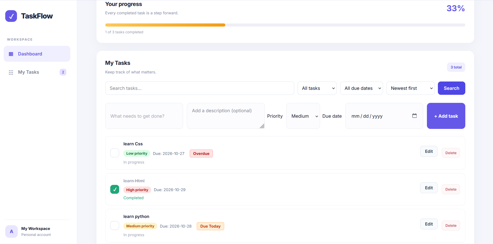
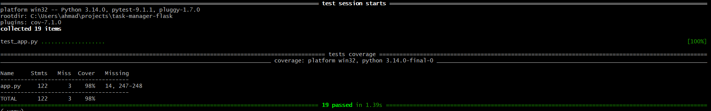

# TaskFlow — Task Manager

TaskFlow is a task management web application built with Python, Flask, and SQLite. It helps users organize tasks, set priorities and due dates, track progress, and quickly find tasks using search and filters.

## Screenshots

### TaskFlow Dashboard


### Test Coverage


## Features

- Create, edit, and delete tasks
- Mark tasks as completed
- Add task descriptions
- Set task priorities and due dates
- Search tasks by title or description
- Filter tasks by completion status
- Filter tasks by due date: overdue, today, and upcoming
- Sort tasks by creation date, priority, or due date
- Display due-date badges
- Track completion progress with a progress bar
- Persist tasks using SQLite

## Tech Stack

- **Backend:** Python, Flask
- **Database:** SQLite
- **Frontend:** HTML, CSS
- **Testing:** pytest
- **Code Coverage:** coverage.py

## Requirements

- Python 3.10 or newer
- pip
- Git (optional, for cloning the repository)

## What I Learned

Building TaskFlow helped me practice and strengthen the following skills:

- **Backend development:** Building web routes and handling form submissions with Flask.
- **Database management:** Storing and managing tasks with SQLite.
- **CRUD operations:** Implementing task creation, editing, deletion, and completion.
- **Frontend development:** Styling a responsive interface with HTML and CSS.
- **Automated testing:** Writing tests with pytest and measuring code coverage with pytest-cov.
- **Version control:** Tracking changes with Git and publishing the project on GitHub.
- **Configuration and security:** Managing environment variables and keeping secret configuration out of version control.

## Installation

### 1. Clone the repository

```bash
git clone https://github.com/Ahmadreza7577/task-manager-flask.git
cd task-manager-flask
```

### 2. Create and activate a virtual environment

On Windows (Git Bash):

```bash
python -m venv .venv
source .venv/Scripts/activate
```

### 3. Install dependencies

```bash
pip install -r requirements.txt
```

### 4. Configure environment variables

Create a `.env` file in the project root and add a secure secret key:

```env
SECRET_KEY=replace-with-a-secure-random-value
```

Do not commit your `.env` file or expose your secret key publicly.

### 5. Run the application

```bash
python app.py
```

Open your browser and visit:

http://127.0.0.1:5000

## Running Tests

Run the test suite:

```bash
pytest -v
```

## Test Coverage

Generate a coverage report:

```bash
coverage run -m pytest
coverage report -m
```

The current test suite contains 19 tests and has achieved 99% overall code coverage.

## Project Structure

```text
task-manager-flask/
├── app.py
├── test_app.py
├── requirements.txt
├── templates/
│   └── index.html
├── static/
│   └── style.css
├── .env
├── .gitignore
└── README.md
```

The `.env` file and local database are excluded from version control where configured in `.gitignore`.

## License

This project is licensed under the MIT License. See the [LICENSE](LICENSE) file for details.